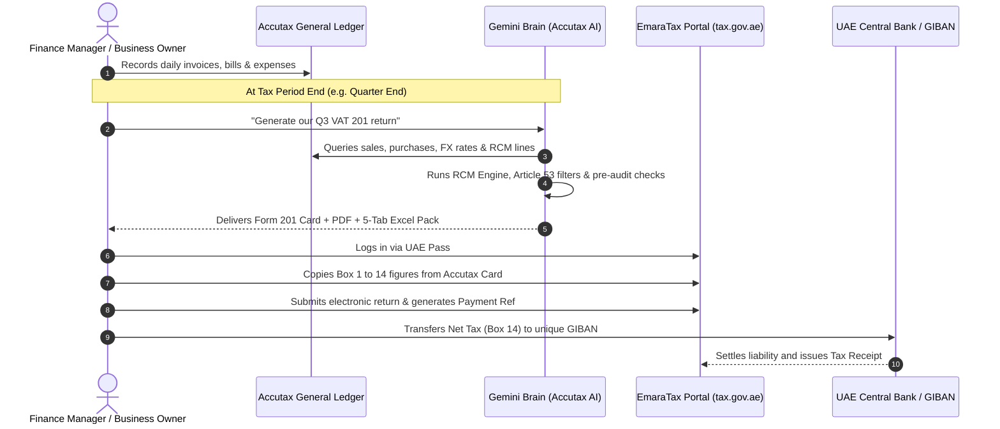
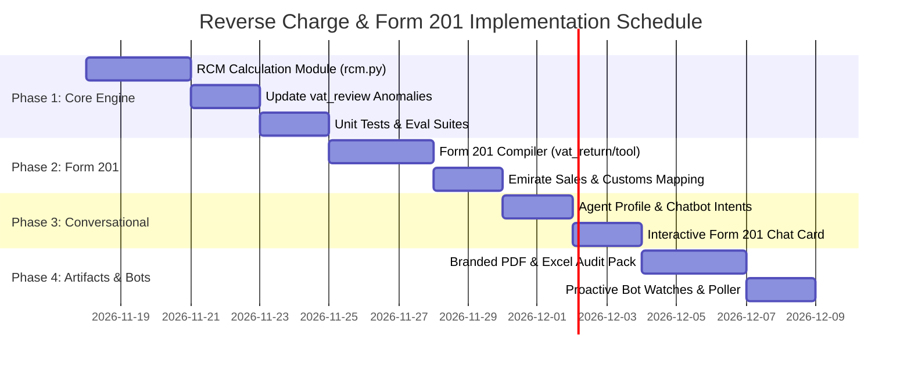

# Reverse Charge Mechanism (RCM) & Form VAT 201 AI Engine
## End-to-End Product Specification, Competitive Analysis, & Engineering Blueprint

* **Product:** `Gemini_Brain_Accutax` (Accutax AI Platform)
* **Author:** Principal AI Systems & Tax Architecture Group
* **Target Jurisdictions:** UAE (Federal Tax Authority - FTA) & GCC / KSA (ZATCA)
* **Status:** Final Architectural Specification
* **Date:** November 2026

---

## Table of Contents
1. [Executive Summary & Strategic Vision](#1-executive-summary--strategic-vision)
2. [Understanding the Reverse Charge Mechanism (RCM)](#2-understanding-the-reverse-charge-mechanism-rcm)
   - 2.1 Statutory & Legal Foundation (UAE Decree-Law No. 8 of 2017)
   - 2.2 Mathematical & Accounting Mechanics
   - 2.3 The Five Critical Real-World Audit Traps
3. [Competitive Product Audit: How Other Platforms Handle RCM](#3-competitive-product-audit-how-other-platforms-handle-rcm)
   - 3.1 Wafeq & WafeqAI
   - 3.2 Ramp & Ramp Intelligence
   - 3.3 Alaan
   - 3.4 Zoho Books (GCC Benchmark)
   - 3.5 Enterprise AI AP Platforms (Hyperbots, Vic.ai, Stampli)
   - 3.6 Comprehensive Feature Parity Matrix
4. [How Business Owners File VAT Returns in Practice](#4-how-business-owners-file-vat-returns-in-practice)
   - 4.1 The EmaraTax Electronic Portal
   - 4.2 The 28-Day Statutory Deadline & Nil Return Mandate
   - 4.3 Government Payment Settlement Channels (GIBAN & Cards)
   - 4.4 End-to-End Filing Lifecycle Flowchart
5. [The Form VAT 201 Statutory Specification](#5-the-form-vat-201-statutory-specification)
   - 5.1 Section-by-Section and Box-by-Box Analysis (Boxes 1 to 14)
   - 5.2 Mapping Data Sources to Boxes
6. [Current State & Gap Analysis in `Gemini_Brain_Accutax`](#6-current-state--gap-analysis-in-gemini_brain_accutax)
   - 6.1 Existing Assets in the Codebase
   - 6.2 Identified Architectural & Data Gaps
7. [The 4-Layer AI Architecture & Implementation Plan](#7-the-4-layer-ai-architecture--implementation-plan)
   - 7.1 Layer 1: Bookkeeping AI Chatbot (Intent, Entity & Planner)
   - 7.2 Layer 2: SQL / Data Retrieval (Cube Core Semantic Layer & Heuristics)
   - 7.3 Layer 3: VAT Calculation Engine (`vat_review/rcm.py`)
   - 7.4 Layer 4: Grounded Answer Generator & Legal Citations
   - 7.5 Layer 5: Proactive Bot Watches & Event Monitors
8. [Generating Form VAT 201 Through Accutax AI](#8-generating-form-vat-201-through-accutax-ai)
   - 8.1 Mode A: Interactive In-Chat Form 201 Card (1-Click Copy-Paste)
   - 8.2 Mode B: Official Branded Form VAT 201 PDF
   - 8.3 Mode C: The 5-Tab "Audit-Proof" Excel Filing Pack (`.xlsx`)
   - 8.4 Autonomous Pre-Filing Audit & CFO Variance Intelligence
9. [Engineering Roadmap & Implementation Tasks](#9-engineering-roadmap--implementation-tasks)

---

## 1. Executive Summary & Strategic Vision

In the GCC cloud accounting and spend automation market, two distinct design philosophies have emerged:
1. **Operational Spend Tools (Ramp, Alaan):** Focus purely on employee card swipes, receipt photo intake, and OCR forwarding into external ERPs. They do not own the general ledger and cannot compute or file taxes.
2. **Traditional Cloud Accounting (Wafeq, Zoho Books):** Maintain double-entry ledgers and generate tax forms, but rely entirely on **manual human data entry** (dropdowns, checkboxes). If a user forgets to tick a "Reverse Charge" box on a foreign software invoice, the system silently files an incorrect return, exposing the business to severe tax authority fines.

**Accutax AI's Breakthrough Opportunity:**
By combining our sovereign General Ledger Core (`accutax_bk_backend`), Cube semantic data layer, and the Gemini Brain AI engine, Accutax can deliver an **Autonomous, Audit-Proof VAT & RCM Platform**:
* Autonomously detects cross-border services (AWS, Google, overseas consultants) without requiring manual dropdown clicks.
* Automatically performs Central Bank daily FX translations, 5% self-assessment math, and Article 53 recoverability filtering.
* Compiles the official **UAE FTA Form VAT 201** across all 14 statutory boxes.
* Delivers interactive copy-paste cards, branded official PDFs, and full 5-tab audit-proof Excel packs directly within chat.

---

## 2. Understanding the Reverse Charge Mechanism (RCM)

### 2.1 Statutory & Legal Foundation
Under standard domestic transactions, the supplier charges VAT on sales, collects it from the buyer, and remits it to the tax authority. However, when a UAE/GCC registered business purchases services or goods from outside the country, foreign suppliers are not registered locally and cannot charge local VAT.

To prevent local businesses from evading tax by buying abroad, tax law implements the **Reverse Charge Mechanism (RCM)**:
* **UAE Legislation:** Federal Decree-Law No. 8 of 2017 on Value Added Tax (**Article 48: Reverse Charge**) and Cabinet Decision No. 52 of 2017 on the Executive Regulations (**Articles 53, 59, and 60**).
* **GCC / KSA Legislation:** Unified VAT Agreement for the GCC (**Article 47**), administered by ZATCA.
* **Core Rule:** The legal obligation to calculate, report, and account for the VAT shifts completely from the seller to the **recipient (buyer)**.

### 2.2 Mathematical & Accounting Mechanics
When a UAE business receives a \$1,000 invoice from Amazon Web Services (AWS) or Google Cloud:
1. The supplier bills \$1,000 with **0% local UAE VAT**.
2. The buyer converts the amount to AED using the official UAE Central Bank exchange rate on the date of supply (e.g., \$1,000 × 3.6725 = AED 3,672.50).
3. The buyer self-assesses **5% Output VAT**: 
   $$\text{Output VAT} = \text{AED } 3,672.50 \times 0.05 = \text{AED } 183.63$$
4. Simultaneously, if the business is fully taxable, it claims **5% Input VAT**:
   $$\text{Recoverable Input VAT} = \text{AED } 183.63$$
5. **Double-Entry Journal Posting:**
   * **Debit:** Software Expense (`AED 3,672.50`)
   * **Debit:** Input VAT Recoverable - RCM (`AED 183.63`)
   * **Credit:** Accounts Payable (`AED 3,672.50`)
   * **Credit:** Output VAT Payable - RCM (`AED 183.63`)
6. **Form VAT 201 Impact:**
   * **Box 3 (Output side):** Reports AED 3,672.50 net amount and AED 183.63 tax due.
   * **Box 10 (Input side):** Reports AED 3,672.50 net amount and AED 183.63 recoverable tax.
   * **Net Cash Due to FTA:** $\text{AED } 183.63 - \text{AED } 183.63 = \mathbf{\text{AED } 0.00}$.

### 2.3 The Five Critical Real-World Audit Traps
Tax authorities (FTA and ZATCA) aggressively audit cross-border expenses because errors here generate massive penalty revenues:
1. **The "Zero-Tax" Omission Trap:** Bookkeepers see \$0 tax on an overseas SaaS invoice and enter it as a standard "0% Zero-Rated" or "Out of Scope" purchase. This leaves Box 3 blank. In an audit, the FTA treats this as **undisclosed output tax** and imposes retrospective tax assessments, 14% annual late-payment interest, and late declaration penalties.
2. **The Blocked Input Tax Trap (Article 53):** If an overseas vendor supplies services related to **client entertainment, hotel dining, or personal motor vehicle use**, the business **must** declare 5% Output VAT in Box 3, but **cannot** recover it in Box 10 under Article 53. The company has a **genuine cash VAT liability** that is often illegally offset to zero by careless bookkeepers.
3. **The Foreign Tax Leakage Trap:** Overseas vendors frequently charge foreign local taxes (e.g. 20% UK VAT or US state sales tax) because the buyer failed to provide their UAE TRN. Businesses illegally claim this foreign tax as UAE input tax or book it as domestic VAT.
4. **The Simplified Tax Invoice Trap:** Under **Article 59, Clause 5**, a simplified tax invoice is **strictly prohibited** for reverse charge transactions. RCM supplies legally require a full tax invoice containing complete buyer details and TRN.
5. **The Currency Conversion Discrepancy:** Converting foreign invoices using commercial bank rates or credit card rates rather than the **official Central Bank of the UAE historical exchange rate** on the date of supply.

---

## 3. Competitive Product Audit: How Other Platforms Handle RCM

### 3.1 Wafeq & WafeqAI
* **Core Paradigm:** Mid-market cloud accounting tailored to UAE and KSA.
* **RCM Capabilities:**
  * Provides a tax treatment selector on bill line items where the user can pick `Reverse Charge` or code `AE`.
  * Purchase lines flagged with reverse charge automatically route their net base and 5% tax amount into Form 201 Box 3 (Output) and Box 10 (Input).
* **Limitations & Blindspots:**
  * **Zero Proactive AI:** Wafeq relies 100% on human clerks remembering to select the dropdown. If an intern creates a bill for AWS and leaves it as standard or zero tax, Wafeq never catches it.
  * **No Article 53 Validation:** Wafeq does not inspect the line item description to determine if input tax recovery is blocked.
  * **No Conversational CFO:** Users cannot query Wafeq in plain English about RCM exposures or quarterly tax reconciliation.

### 3.2 Ramp & Ramp Intelligence
* **Core Paradigm:** US-centric corporate spend management and AP automation.
* **RCM Capabilities:**
  * Excellent OCR line-item extraction and multi-currency parsing.
  * Automatically assigns custom GL tracking categories to foreign vendor bills and card swipes before syncing to NetSuite, QuickBooks, or Xero.
  * Provides an API integration with **VAT IT** for reclaiming foreign VAT incurred on employee travel.
* **Limitations & Blindspots:**
  * **Not a Sovereign Ledger:** Ramp does not maintain the general ledger or compute tax returns.
  * **Zero GCC Localization:** Ramp has no concept of UAE FTA Form 201, EmaraTax, ZATCA, Box 3, or Box 10. All tax filing responsibility is offloaded to external ERPs.

### 3.3 Alaan
* **Core Paradigm:** GCC corporate card and spend management platform.
* **RCM Capabilities:**
  * Real-time card capture; OCR scans receipts for 15-digit UAE TRNs and flags receipts missing TRNs.
* **Limitations & Blindspots:**
  * **Spend Front-End Only:** Alaan has no sovereign accounting engine. It cannot perform reverse-charge journal entries, self-assessed tax accounting, or VAT 201 generation.

### 3.4 Zoho Books (GCC Benchmark)
* **Core Paradigm:** Enterprise SME accounting with established UAE/KSA compliance.
* **RCM Capabilities:**
  * Explicit checkbox: *"This transaction is applicable for reverse charge"*.
  * Automated dual ledger postings: debits Input VAT and credits Output VAT simultaneously.
  * Integrates Customs Declaration (CD) numbers for imported physical goods.
* **Limitations & Blindspots:**
  * Traditional rule-based UI with zero conversational intelligence.
  * Cannot answer natural language questions, perform autonomous anomaly audits, or explain tax variance drivers to business owners.

### 3.5 Enterprise AI AP Automation (Hyperbots, Vic.ai, Stampli)
* **Core Paradigm:** Tier-1 autonomous accounts payable for large global enterprises.
* **RCM Capabilities:**
  * OCR + LLM contextual understanding: parses invoice text to detect *"Reverse charge applies"* or legal references (Article 196, Article 48).
  * Vendor master cross-referencing: identifies unregistered foreign vendors delivering digital goods/services.
  * Autonomous generation of self-invoices and ERP journal postings.
* **Limitations & Blindspots:**
  * High-cost enterprise pricing (\$30k–\$100k+/year).
  * Lacks native UAE FTA statutory form compilers; requires complex middleware to connect to regional filing workflows.

### 3.6 Comprehensive Feature Parity Matrix

| Feature Dimension | Wafeq | Ramp | Alaan | Zoho Books | Hyperbots / Vic.ai | Accutax AI (Proposed) |
|---|:---:|:---:|:---:|:---:|:---:|:---:|
| **Sovereign General Ledger** | Yes | No | No | Yes | No (ERP connector) | **Yes** |
| **Manual RCM Tax Treatment Selection** | Yes | Yes (Tags) | No | Yes | Yes | **Yes** |
| **Autonomous Heuristic RCM Detection** | No | Partial | No | No | Yes | **Yes (AI)** |
| **Official Central Bank FX Rate Table** | Yes | No (Market FX) | No | Yes | Yes | **Yes (`uploads/fx.py`)** |
| **Article 53 Blocked Recovery Engine** | No | No | No | No | Partial | **Yes (Dedicated)** |
| **Automated Form VAT 201 Compilation** | Yes | No | No | Yes | No | **Yes (Boxes 1–14)** |
| **Interactive In-Chat Copy-Paste Card** | No | No | No | No | No | **Yes (Unique)** |
| **Branded Official Form 201 PDF Export**| Yes | No | No | Yes | No | **Yes (`artifacts/`)** |
| **5-Tab Excel Audit Pack (.xlsx)** | No | No | No | Partial | No | **Yes (Audit-Ready)** |
| **Conversational RCM Q&A / Virtual CFO**| No | Basic | No | No | No | **Yes (`Axi` / Brain)** |
| **Proactive Bot Watches for Missed RCM**| No | No | No | No | Yes (Alerts) | **Yes (`bots/`)** |

---

## 4. How Business Owners File VAT Returns in Practice

### 4.1 The EmaraTax Electronic Portal
Filing a VAT return in the UAE is **100% digital**. The Federal Tax Authority (FTA) mandates that all registered businesses file via the **EmaraTax** portal (`tax.gov.ae`).
* **Authentication:** Access is authenticated via corporate credentials or **UAE Pass** (the national digital identity).
* **Filing Surface:** The user navigates to `VAT` $\rightarrow$ `My Filings` $\rightarrow$ `Initiate VAT 201 – New Return` for the active tax period.
* **Input Method:** EmaraTax presents an electronic form with predetermined numeric input boxes. Users must manually enter or verify figures for net amounts and tax amounts.

### 4.2 The 28-Day Statutory Deadline & Nil Return Mandate
* **Deadline:** The VAT 201 return and full payment must be submitted no later than the **28th day** following the end of the tax period (Executive Regulation Article 55).
  * *Example:* For Q1 ending March 31, the deadline is **April 28**. If the 28th falls on a public holiday or weekend, it extends to the first subsequent business day.
* **Nil Return Mandate:** Even if a company recorded **AED 0 revenue and AED 0 expenses**, filing is **strictly mandatory**.
  * Failing to file a Nil return triggers an immediate **AED 1,000 late return penalty** (AED 2,000 for repeated offenses within 24 months) plus 14% annual interest on unpaid tax.

### 4.3 Government Payment Settlement Channels
When Box 14 results in a net tax liability, the taxpayer settles via EmaraTax using:
1. **GIBAN (Generated International Bank Account Number):** A unique, dedicated virtual IBAN assigned to each taxpayer by the UAE Central Bank. Wire transfers sent to this GIBAN automatically reconcile against the tax liability.
2. **Online Card Payments (MagnatiPay):** Real-time settlement using corporate debit/credit cards (Visa/Mastercard) directly on the portal.

### 4.4 End-to-End Filing Lifecycle Flowchart



---

## 5. The Form VAT 201 Statutory Specification

The table below outlines the complete statutory layout of **Form VAT 201** as mandated by the FTA, along with how each box maps to accounting data:

```
====================================================================================================
UAE FEDERAL TAX AUTHORITY — FORM VAT 201 RETURN
====================================================================================================
Section 1: Taxable Person Details (Auto-populated: Legal Name, TRN, Address, Period Dates)
----------------------------------------------------------------------------------------------------
Section 2: VAT on Sales and All Other Outputs
----------------------------------------------------------------------------------------------------
Box 1a: Standard-rated supplies in Abu Dhabi                   [Net Amount AED]  [Output VAT 5%]
Box 1b: Standard-rated supplies in Dubai                       [Net Amount AED]  [Output VAT 5%]
Box 1c: Standard-rated supplies in Sharjah                     [Net Amount AED]  [Output VAT 5%]
Box 1d: Standard-rated supplies in Ajman                       [Net Amount AED]  [Output VAT 5%]
Box 1e: Standard-rated supplies in Umm Al Quwain               [Net Amount AED]  [Output VAT 5%]
Box 1f: Standard-rated supplies in Ras Al Khaimah              [Net Amount AED]  [Output VAT 5%]
Box 1g: Standard-rated supplies in Fujairah                    [Net Amount AED]  [Output VAT 5%]
Box 2:  Tax refunds provided to tourists under digital scheme  [Net Amount AED]  [Output VAT Adjustment]
Box 3:  Supplies subject to the Reverse Charge provisions      [Net Amount AED]  [Output VAT 5%]
Box 4:  Zero-rated supplies (Exports, international transport) [Net Amount AED]  [N/A - 0%]
Box 5:  Exempt supplies (Financial margins, local passenger)   [Net Amount AED]  [N/A - 0%]
Box 6:  Goods imported into the UAE (Customs declarations)     [Net Amount AED]  [Output VAT 5%]
Box 7:  Adjustments to goods imported into the UAE             [Net Amount AED]  [Output VAT Adjustment]
----------------------------------------------------------------------------------------------------
Box 8:  TOTAL VALUE OF DUE TAX (Sum of Output VAT Boxes 1 to 7)                  [TOTAL OUTPUT VAT]
====================================================================================================
Section 3: VAT on Expenses and All Other Inputs
----------------------------------------------------------------------------------------------------
Box 9:  Standard-rated expenses (Local purchases @ 5%)         [Net Amount AED]  [Recoverable VAT]
Box 10: Supplies subject to Reverse Charge (Recoverable input) [Net Amount AED]  [Recoverable VAT]
----------------------------------------------------------------------------------------------------
Box 11: TOTAL VALUE OF RECOVERABLE TAX (Sum of Input VAT Boxes 9 & 10)           [TOTAL INPUT VAT]
====================================================================================================
Section 4: Net VAT Due or Refundable
----------------------------------------------------------------------------------------------------
Box 12: Total value of due tax for the period (from Box 8)                       [TOTAL OUTPUT VAT]
Box 13: Total value of recoverable tax for the period (from Box 11)              [TOTAL INPUT VAT]
----------------------------------------------------------------------------------------------------
Box 14: PAYABLE TAX FOR THE PERIOD (Box 12 minus Box 13)                         [NET VAT PAYABLE]
====================================================================================================
```

---

## 6. Current State & Gap Analysis in `Gemini_Brain_Accutax`

### 6.1 Existing Assets in the Codebase
The `Gemini_Brain_Accutax` repository possesses advanced building blocks for VAT:
1. **Clean-Room Knowledge Base (`vat_kb`):**
   * Indexed official UAE FTA documentation from `tax.gov.ae`.
   * Search expansion in `vat_kb/expansion.py` already includes `"import of services; reverse charge mechanism; the recipient shall be responsible for calculating and paying the Tax"`.
2. **OCR Parsing Engine (`uploads/extract.py`):**
   * `DocumentExtract` dataclass already includes `reverse_charge_statement: Optional[bool]` and `currency: str`.
3. **Legal Invoice Rule Validator (`uploads/invoice_rules.py`):**
   * Directly enforces Article 59 clause 5: *"A simplified tax invoice cannot be used when the recipient accounts for the VAT (reverse charge): a full tax invoice is needed."*
4. **Central Bank Exchange Rate Engine (`uploads/fx.py`):**
   * Ships with official Central Bank rates (`config/aed_rates.json`) for converting foreign currencies into AED.
5. **Periodic VAT Return Engine (`vat_return/tool.py`):**
   * Correctly calculates tax periods, quarter groupings, due dates (28-day rule), and late payment/filing penalty schedules under Cabinet Decision No. 129 of 2025 (`vat_return/penalty.py`).
6. **Artifact Generator (`artifacts/generate.py`):**
   * Full multi-format rendering engine supporting branded PDF, Excel (`.xlsx`), DOCX, and PPTX.

### 6.2 Identified Architectural & Data Gaps
1. **Cube Model Missing Box 3 & 10 (`semantic/model/cubes/vat_lines.yml`):**
   * Output VAT is derived only from `sales_lines`, and Input VAT only from `purchase_lines`.
   * Reverse-charge supplies are not modeled in Cube; Box 3 and Box 10 do not exist.
2. **False Positives in `vat_review/anomalies.py`:**
   * Overseas bills with 0% domestic tax (e.g. AWS or Google) are flagged as `vat_zero` (*"No VAT is recorded... That is correct only for zero-rated, exempt or out-of-scope purchases"*). They are not recognized as RCM candidates.
3. **No Article 53 Recoverability Filtering:**
   * The system does not inspect expense lines to check if input tax recovery is blocked for client dining, hotels, or motor vehicles.
4. **No Comprehensive Form 201 Generator:**
   * `vat_return/tool.py` returns only 4 high-level metrics (`output_vat`, `input_vat`, `net_vat_payable`, `standard_rated_sales`) rather than the complete 14-box statutory structure.

---

## 7. The 4-Layer AI Architecture & Implementation Plan

The architecture follows the operational flow shown in the system diagram:

```
User / Finance Manager (Natural language questions)
         ↓
Bookkeeping AI Chatbot (Intent classification · Entity resolution · Query planning)
         ↓
[SQL / Data Retrieval]  <----->  [VAT Calculation Engine]
Invoices, suppliers,             RCM rules, recoverability,
tax codes, journal entries       output/input VAT, reconciliation
         ↓
Grounded Answer Generator (Numbers + calculations + invoice references + explanations)
```

### 7.1 Layer 1: Bookkeeping AI Chatbot
* **File:** `backend/src/gemini_brain/agent/profiles.py` & `vat_kb/detector.py`
* **Intent Classification:**
  * `vat.rcm_position`: Natural language inquiries about reverse-charge exposure (e.g., *"How much reverse charge do we owe for Q3?"*).
  * `vat.form_201_generate`: Demands for the official return (e.g., *"Generate our Form 201 return for last quarter"*).
  * `vat.check_document_rcm`: Document-level review (e.g., *"Does reverse charge apply to this attached invoice?"*).
* **Entity Resolution:** Resolves specific organizations, tax quarters, currencies, and foreign vendors.

### 7.2 Layer 2: SQL / Data Retrieval Layer
Queries the read-only Cube data warehouse and document store:

#### RCM Heuristic Extraction Query (Runs without requiring backend DB migrations):
```sql
SELECT 
    p.document_id,
    p.document_number,
    p.document_date,
    p.vendor_name,
    p.vendor_trn,
    p.currency,
    p.line_amount,
    p.tax_amount,
    p.description
FROM purchases p
WHERE p.organization_id = :org_id
  AND p.document_date BETWEEN :start_date AND :end_date
  AND (
      p.currency != 'AED'
      OR (p.vendor_trn IS NULL OR LENGTH(p.vendor_trn) != 15)
      OR LOWER(p.vendor_name) SIMILAR TO '%(aws|amazon web services|google|microsoft|zoom|stripe|meta|linkedin|github|adobe|openai|canva|slack)%'
  )
  AND (p.tax_amount = 0 OR p.tax_amount IS NULL);
```

### 7.3 Layer 3: VAT Calculation Engine (`backend/src/gemini_brain/vat_review/rcm.py`)
A dedicated, deterministic Python module executing tax math and legal rules:

```python
"""rcm.py — Reverse Charge Mechanism calculation and compliance engine.
Governed by UAE Federal Decree-Law No. 8 of 2017 (Article 48) and Executive Regulation Articles 53 & 59.
"""
from __future__ import annotations

import datetime as dt
from dataclasses import dataclass, field
from typing import Any, Dict, List, Optional, Sequence

from gemini_brain.uploads.fx import aed_rate

STANDARD_RATE = 0.05

KNOWN_SAAS_VENDORS = frozenset([
    "aws", "amazon web services", "google", "google cloud", "google workspace",
    "microsoft", "azure", "zoom", "stripe", "meta", "facebook", "linkedin",
    "github", "adobe", "openai", "canva", "slack", "salesforce", "hubspot",
    "notion", "figma", "digitalocean", "cloudflare", "godaddy", "twilio"
])

BLOCKED_RECOVERY_KEYWORDS = frozenset([
    "entertainment", "dining", "restaurant", "catering", "hotel", "hospitality",
    "motor vehicle", "car lease", "car rental", "passenger car"
])

@dataclass(frozen=True)
class RCMItem:
    document_id: str
    document_number: str
    document_date: str
    vendor_name: str
    original_currency: str
    original_amount: float
    fx_rate: float
    amount_aed: float
    box3_output_vat_aed: float
    recovery_rate: float          # 1.0 = 100% recoverable, 0.0 = blocked under Article 53
    box10_input_vat_aed: float
    net_vat_payable_aed: float
    compliance_flags: List[str] = field(default_factory=list)


def evaluate_rcm_bill(bill: Dict[str, Any], org_recovery_ratio: float = 1.0) -> Optional[RCMItem]:
    """Evaluates whether a purchase bill is subject to RCM and calculates self-assessed tax."""
    vendor = str(bill.get("vendor_name") or "").lower()
    currency = str(bill.get("currency") or "AED").upper()
    trn = str(bill.get("vendor_trn") or "").strip()
    line_amount = float(bill.get("net_purchases") or bill.get("line_amount") or 0.0)
    tax_amount = float(bill.get("tax_amount") or bill.get("input_vat") or 0.0)
    doc_date = str(bill.get("document_date") or dt.date.today().isoformat())[:10]
    description = str(bill.get("description") or "").lower()
    doc_kind = str(bill.get("document_type") or "full").lower()

    is_foreign = (currency != "AED") or (len(trn) != 15)
    is_known_saas = any(s in vendor for s in KNOWN_SAAS_VENDORS)
    has_rcm_statement = bool(bill.get("reverse_charge_statement"))

    if not (is_foreign or is_known_saas or has_rcm_statement):
        return None

    flags = []
    # Anomaly: Overseas supplier improperly charged foreign local VAT
    if tax_amount > 0 and is_foreign and len(trn) != 15:
        flags.append("foreign_tax_charged_erroneously")

    # Legal violation: Simplified invoice used for RCM (Article 59 clause 5)
    if doc_kind == "simplified":
        flags.append("simplified_invoice_rcm_prohibited")

    # Currency conversion via official Central Bank rate
    rate = aed_rate(currency, doc_date) or 1.0
    amount_aed = round(line_amount * rate, 2)
    output_vat_aed = round(amount_aed * STANDARD_RATE, 2)

    # Article 53 blocked recovery evaluation
    recovery_rate = org_recovery_ratio
    if any(k in description for k in BLOCKED_RECOVERY_KEYWORDS):
        recovery_rate = 0.0
        flags.append("blocked_input_tax_article53")

    input_vat_aed = round(output_vat_aed * recovery_rate, 2)
    net_payable = round(output_vat_aed - input_vat_aed, 2)

    return RCMItem(
        document_id=str(bill.get("document_id") or ""),
        document_number=str(bill.get("document_number") or "N/A"),
        document_date=doc_date,
        vendor_name=bill.get("vendor_name") or "Unknown Vendor",
        original_currency=currency,
        original_amount=line_amount,
        fx_rate=rate,
        amount_aed=amount_aed,
        box3_output_vat_aed=output_vat_aed,
        recovery_rate=recovery_rate,
        box10_input_vat_aed=input_vat_aed,
        net_vat_payable_aed=net_payable,
        compliance_flags=flags,
    )
```

### 7.4 Layer 4: Grounded Answer Generator
Never allows LLM hallucination of accounting numbers. All output figures are compiled directly from the RCM engine and Form 201 compiler:
* Formats structured markdown tables.
* Includes verified legal citations from `tax.gov.ae` (Article 48, Article 53, Article 59).
* Proactively highlights audit warnings.

### 7.5 Layer 5: Proactive Bot Watches (`bots/watches.py` & `bots/agents_vat.py`)
Registers a new automated watch into the scheduled bot framework:
```python
Watch(
    id="rcm_unaccounted",
    label="Foreign service bills missing reverse-charge self-assessment",
    side="purchases",
    rules=("rcm_candidate_unrecorded", "rcm_foreign_tax_mismatch", "rcm_simplified_invoice"),
    default_on=True,
    desc="Cross-border SaaS or service bills (e.g. AWS, Google) that must be reported in Box 3 and 10.",
    bar="Reverse charge missing",
)
```

---

## 8. Generating Form VAT 201 Through Accutax AI

### 8.1 Mode A: Interactive In-Chat Form 201 Card
When a user asks: *"Show our Q3 VAT 201 return"*, Axi renders a dedicated interactive card with individual copy triggers:

```
┌────────────────────────────────────────────────────────────────────────┐
│  FEDERAL TAX AUTHORITY — FORM VAT 201 RETURN (Q3 2026)                 │
│  Entity: ACME Trading LLC · TRN: 100234567800003 · Status: Verified   │
├────────────────────────────────────────────────────────────────────────┤
│  OUTPUT TAX (SALES & REVERSE CHARGE)                                   │
│  Box 1b (Dubai Standard Supplies):   AED 450,000.00 | VAT: AED 22,500  │ [Copy]
│  Box 3  (Reverse Charge Supplies):   AED  35,200.00 | VAT: AED  1,760  │ [Copy]
│  Box 4  (Zero-Rated Supplies):       AED  80,000.00 | VAT: AED      0  │ [Copy]
│  Box 8  (TOTAL OUTPUT TAX DUE):                             AED 24,260 │ [Copy]
├────────────────────────────────────────────────────────────────────────┤
│  INPUT TAX (PURCHASES & EXPENSES)                                      │
│  Box 9  (Standard Rated Expenses):   AED 120,000.00 | VAT: AED  6,000  │ [Copy]
│  Box 10 (Reverse Charge Input VAT):  AED  35,200.00 | VAT: AED  1,760  │ [Copy]
│  Box 11 (TOTAL RECOVERABLE TAX):                            AED  7,760 │ [Copy]
├────────────────────────────────────────────────────────────────────────┤
│  NET TAX SETTLEMENT                                                    │
│  Box 14 (NET VAT PAYABLE TO FTA):                           AED 16,500 │ [Copy]
└────────────────────────────────────────────────────────────────────────┘
 [ Download Official PDF ]   [ Export 5-Tab Audit Pack (.xlsx) ]
```

### 8.2 Mode B: Official Branded Form VAT 201 PDF
Generated via `gemini_brain/artifacts/generate.py`. Follows official FTA document branding with legal headers, timestamped audit verification, and declaration signatories.

### 8.3 Mode C: The 5-Tab "Audit-Proof" Excel Filing Pack (`.xlsx`)
Prepares the complete audit trail supporting the return:
* **Tab 1: Form 201 Summary:** High-level statutory box figures.
* **Tab 2: Sales by Emirate (Box 1):** Line-by-line invoice schedule with customer TRNs.
* **Tab 3: RCM Schedule (Box 3 & 10):** Foreign invoices (AWS, Google, overseas contractors), original currencies, Central Bank FX rates, AED bases, and Article 53 recovery flags.
* **Tab 4: Standard Purchases (Box 9):** Local purchase bills with verified 15-digit supplier TRNs.
* **Tab 5: GL Control Reconciliation:** Compares Form 201 tax payable against general ledger VAT accounts (`214100 Output VAT`, `114100 Input VAT`).

### 8.4 Autonomous Pre-Filing Audit & CFO Variance Intelligence
Before finalizing the return, the AI runs automated sanity checks:
1. **TRN Format Validation:** Warns if local input VAT was claimed on suppliers lacking a valid 15-digit TRN.
2. **Variance Explanation:** Explains quarter-over-quarter shifts in natural language:
   > *"Net VAT payable increased by AED 14,200 compared to Q2. This was driven by a 22% increase in Dubai retail sales, offset by AED 1,760 of self-assessed reverse-charge tax on new AWS cloud deployments."*

---

## 9. Engineering Roadmap & Implementation Tasks



### Detailed Task Breakdown:
1. **Task 1: Core RCM Module (`backend/src/gemini_brain/vat_review/rcm.py`)**
   * Implement `evaluate_rcm_bill()`, `KNOWN_SAAS_VENDORS`, FX rate lookups, and Article 53 blocked checks.
   * Tests: `tests/unit/test_vat_rcm.py` covering multi-currency SaaS, blocked dining, and foreign tax errors.
2. **Task 2: Anomaly Engine Refactor (`backend/src/gemini_brain/vat_review/anomalies.py`)**
   * Split `vat_zero` into `rcm_candidate_unrecorded` for foreign vendors.
   * Add `rcm_foreign_tax_mismatch` and `rcm_simplified_invoice` rules.
3. **Task 3: Form VAT 201 Compilation Tool (`backend/src/gemini_brain/vat_return/tool.py`)**
   * Expand `vat_return` to return full 14-box structure dictionary.
   * Compute Box 3 and Box 10 from the RCM engine.
4. **Task 4: Artifact Specs (`backend/src/gemini_brain/artifacts/report_spec.py`)**
   * Create `VAT201Spec` generating the official PDF layout and 5-tab Excel workbook.
5. **Task 5: Proactive Bot Watch (`backend/src/gemini_brain/bots/agents_vat.py`)**
   * Register `rcm_unaccounted` watch.
   * Enable scheduled monitoring for cross-border transactions.
